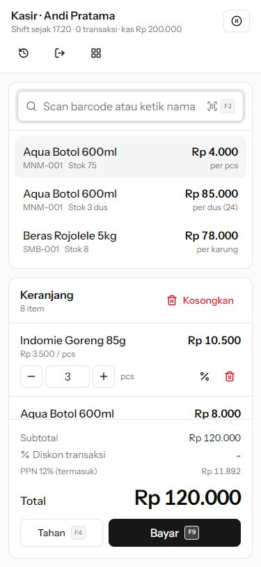
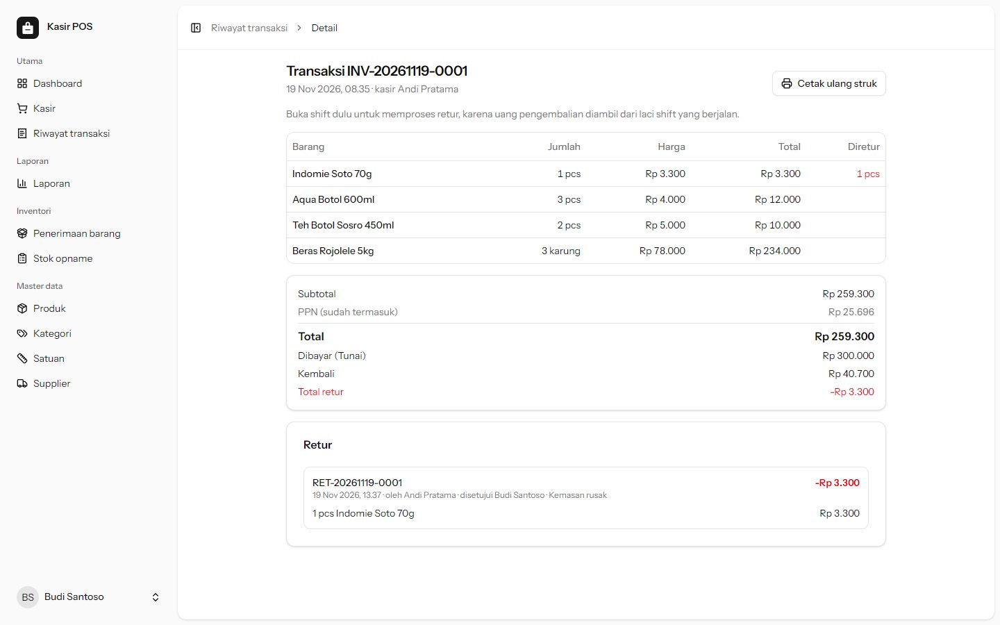
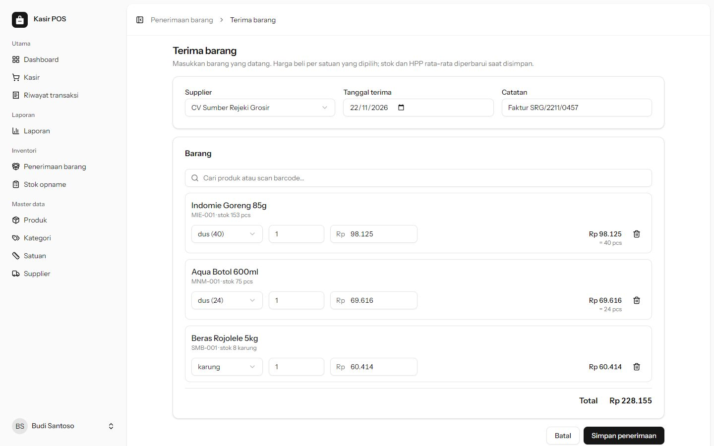
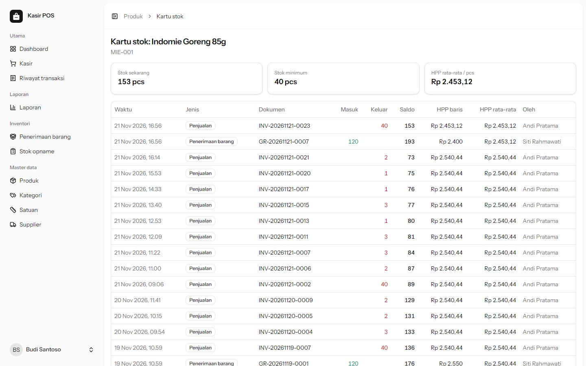
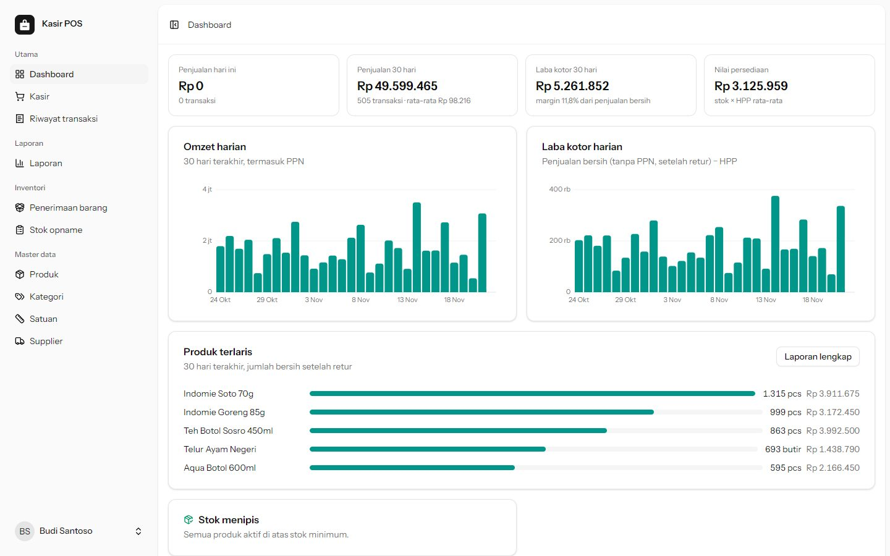
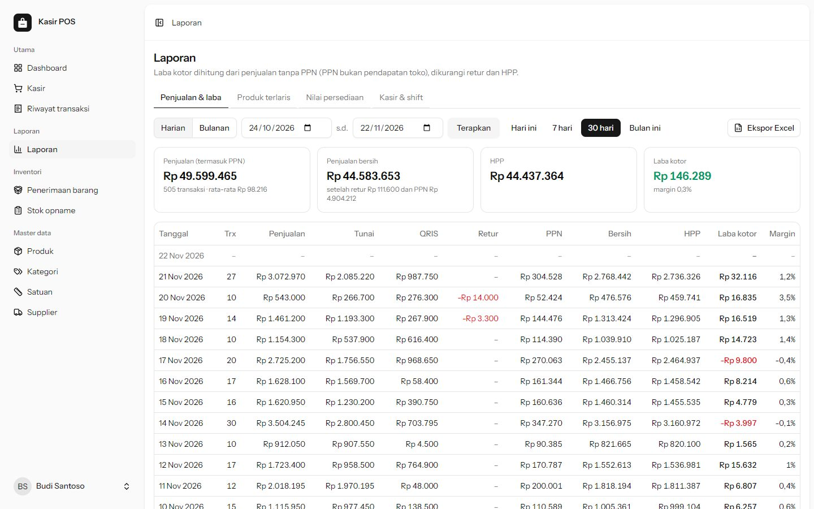

# Kasir POS + Stock Management

A point-of-sale and inventory web app for a single Indonesian shop (warung / minimarket), built as a full-stack portfolio project.
**Stack:** Laravel 13 · Inertia 3 · React 19 · TypeScript · Tailwind 4 · shadcn/ui · PostgreSQL 17 · Pest.


_Cash checkout from scan to change (animated PNG). All screenshots use the 30-day demo data from `DemoSalesSeeder`._

## Features

- **Till (kasir):** barcode scan, pcs / pack / carton units, item and cart discounts, held carts, keyboard shortcuts (F2 search, F4 hold, F8 held, F9 pay), cash with change, **QRIS via Midtrans**, 58/80 mm thermal receipts printed from the browser, reprints marked _SALINAN_. Works down to phone width.

  <p> </p>

- **Shifts:** opening float, expected vs counted cash at close; refunds come out of the running drawer.
- **Returns:** limited to what was sold minus earlier returns, approved with an **owner PIN**, refund = what the customer actually paid (transaction discount and PPN apportioned to the rupiah).

  

- **Inventory:** products with tiered units, categories, units, suppliers, goods receipts, stock opname (draft → post), stock card per product, low-stock badge.

  <p> </p>

- **Owner reports:** sales and gross profit per day/month, best sellers, inventory value, per-cashier/shift recap, **Excel export**; dashboard with charts.

  <p> </p>

- **Indonesian rules:** PPN 12% on DPP 11/12 (effective 11%), prices incl. or excl. tax, Rupiah formatting, Asia/Jakarta calendar days.
- Roles: **owner**, **gudang** (warehouse), **kasir** (cashier).

### Gallery

| Till                                                                                              | Till, 375 px                                                                                       | Owner dashboard                                                                   |
| ------------------------------------------------------------------------------------------------- | -------------------------------------------------------------------------------------------------- | --------------------------------------------------------------------------------- |
| [](docs/screenshots/kasir.jpg)                                 | [](docs/screenshots/kasir-mobile.jpg)         | [](docs/screenshots/dashboard.jpg)    |
| **Sales & gross profit**                                                                          | **Best sellers**                                                                                   | **Stock card**                                                                    |
| [](docs/screenshots/laporan-penjualan.jpg) | [](docs/screenshots/produk-terlaris.jpg)      | [](docs/screenshots/kartu-stok.jpg) |
| **Sale with a return**                                                                            | **Goods receipt**                                                                                  |                                                                                   |
| [](docs/screenshots/detail-retur.jpg)                 | [](docs/screenshots/penerimaan-barang.jpg) |                                                                                   |

## Stock architecture

- `stock_movements` is an append-only **ledger** and the single source of truth. Every change (purchase, sale, return, opname) is one row; corrections are new rows.
- `products.stock_on_hand` / `avg_cost` are a **cache** updated in the same transaction by `App\Services\Inventory\StockLedger`, under `SELECT … FOR UPDATE` on the product row, locking products in id order so concurrent tills cannot oversell or deadlock.
- HPP uses the **moving average**: incoming purchases and returns re-weight it; sales and opname go out at the current average. Money is integer Rupiah; HPP is `decimal(15,4)` with bcmath.
- `php artisan stock:rebuild [--fix]` replays the ledger and compares it with the cache.
- QRIS sales wait as `pending_payment` without touching stock; the signed Midtrans webhook (or the till's status polling) settles them idempotently, and only then is stock issued.
- Gross profit is reported **excluding PPN** (PPN is collected for the state, not income), net of returns at their original HPP.

## Running locally

Requirements: PHP 8.4+, Composer, Node 22+, PostgreSQL 17.

```bash
composer install && npm install
cp .env.example .env && php artisan key:generate   # set DB_* in .env
php artisan migrate --seed    # APP_ENV=local also seeds 30 days of demo sales
npm run build                 # or: composer dev
```

### Docker (Laravel Sail)

```bash
docker run --rm -v "$(pwd)":/var/www/html -w /var/www/html laravelsail/php85-composer:latest composer install
./vendor/bin/sail up -d
./vendor/bin/sail artisan migrate --seed
```

First boot creates `.env`, the app key and the frontend build (`docker/sail-start.sh`). The app is on http://localhost (set `APP_PORT` to change it).

### QRIS (Midtrans sandbox)

Put your sandbox server key in `.env`: `MIDTRANS_SERVER_KEY` (on the current Midtrans dashboard, an API key with Core API → Write and Cancel transaction → Write), `MIDTRANS_IS_PRODUCTION=false`. The client key is not used. The notification URL is `POST /webhooks/midtrans`; without a public URL the till still learns about payments by polling Midtrans.

### Deploy (Render + Neon, free tiers)

The repo ships a production `Dockerfile` (FrankenPHP, PHP 8.5) and a Render Blueprint (`render.yaml`): one free web service in Singapore, with the database on [Neon](https://neon.tech) (free PostgreSQL that doesn't expire).

1. **Neon:** create a project in the Singapore region and copy the **direct** connection string (connection pooling off).
2. **App key:** run `php artisan key:generate --show` locally and copy the `base64:…` value.
3. **Render:** New → Blueprint → pick this repo. Fill in `APP_KEY`, `DB_URL` (the Neon string) and optionally `MIDTRANS_SERVER_KEY`.

Each boot runs migrations; with `DEMO_SEED=true` it also seeds the demo accounts, catalogue and (with `POS_DEMO_SALES_HISTORY=true`) 30 days of sales in the background. For Midtrans, set the payment notification URL to `https://<your-app>.onrender.com/webhooks/midtrans`. Free instances sleep after 15 minutes idle, so the first request after that takes a while.

## Demo accounts

| Role      | Email             | Password |
| --------- | ----------------- | -------- |
| Owner     | owner@kasir.test  | password |
| Warehouse | gudang@kasir.test | password |
| Cashier   | kasir@kasir.test  | password |

Owner approval PIN for returns: `1234`.

## Tests

```bash
composer test                                        # Pint + PHPStan + Pest (SQLite in memory)
DB_CONNECTION=pgsql DB_DATABASE=kasir_pos_test php vendor/bin/pest   # PostgreSQL, incl. race tests
npm run check && npm run types:check
```

`tests/Concurrency` runs two database connections (a second PHP process) racing for the last unit; CI runs it on PostgreSQL 17.

## Roadmap

Purchase orders with partial receipt, batches and expiry dates, split payments, customer credit (kasbon), multi-branch with stock transfers, offline PWA, direct ESC/POS printing, user management screen.

---

## Ringkasan (Bahasa Indonesia)

Aplikasi kasir dan manajemen stok untuk satu toko: layar kasir dengan barcode, satuan bertingkat, diskon, tahan transaksi, pembayaran tunai dan QRIS (Midtrans), struk thermal, shift dan rekap kas, retur dengan PIN owner, penerimaan barang, stok opname, kartu stok, peringatan stok minimum, laporan penjualan dan laba kotor, produk terlaris, nilai persediaan, rekap kasir, serta ekspor Excel. Stok dicatat di buku besar `stock_movements` dengan HPP moving average; PPN 12% dengan DPP 11/12. Jalankan dengan `php artisan migrate --seed` (atau Sail), lalu masuk dengan akun demo di atas.
