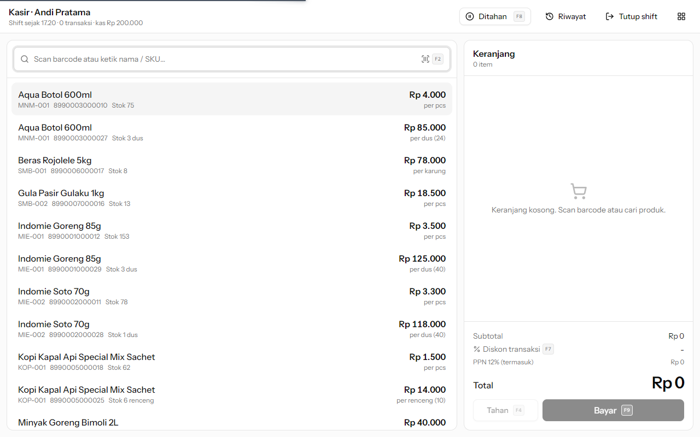
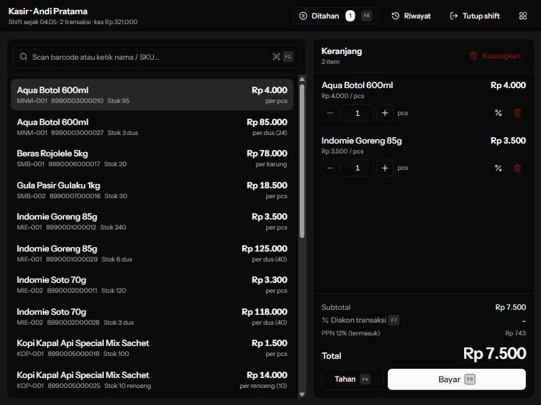
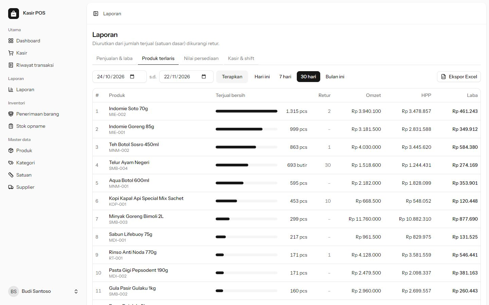

# Kasir POS + Stock Management

A point-of-sale and inventory web app for a single Indonesian shop (warung / minimarket), built as a full-stack portfolio project.
**Stack:** Laravel 13 · Inertia 3 · React 19 · TypeScript · Tailwind 4 · shadcn/ui · PostgreSQL 17 · Pest.



_Cash checkout from scan to change (animated PNG). All screenshots use the 30-day demo data from `DemoSalesSeeder`._

## Features

- **Till (kasir):** barcode scan, pcs / pack / carton units, item and cart discounts, held carts, keyboard shortcuts (F2 search, F4 hold, F8 held, F9 pay), cash with change, **QRIS via Midtrans**, mixed cash + QRIS, 58/80 mm thermal receipts printed from the browser, reprints marked _SALINAN_. Works down to phone width.

  <p> </p>

- **Shifts:** opening float, expected vs counted cash at close; refunds come out of the running drawer. An owner can close a shift someone left open (from the shift recap or **Pengguna**) with the counted drawer and a reason: waiting QRIS payments are checked with Midtrans and cancelled if unpaid, held carts are dropped, and the recap and Excel export show who closed it and why.
- **Returns:** limited to what was sold minus earlier returns, approved with an **owner PIN**, refund = what the customer actually paid (transaction discount and PPN apportioned to the rupiah).

  

- **Inventory:** products with tiered units, categories, units, suppliers, goods receipts, stock opname (draft → post), stock card per product, low-stock badge.

  <p> </p>

- **Purchase orders:** draft → order → receive in one or more deliveries (never more than is outstanding) → received, or close the rest / cancel with a reason. Drafts can be prefilled from low stock (last purchase unit and price, enough for twice the minimum). Orders never move stock: each delivery is an ordinary goods receipt costed at the invoice price.
- **Owner reports:** sales and gross profit per day/month, best sellers, inventory value, per-cashier/shift recap, **Excel export**; dashboard with charts.

  <p> </p>

- **Indonesian rules:** PPN 12% on DPP 11/12 (effective 11%), prices incl. or excl. tax, Rupiah formatting, Asia/Jakarta calendar days.
- Roles: **owner**, **gudang** (warehouse), **kasir** (cashier). No self sign-up: the owner manages accounts under **Pengguna** (add with a starting password, change name / email / role, deactivate and reactivate, reset a password, clear another owner's PIN, and clear the 2FA and passkeys of someone who lost their phone, confirmed with the owner's own password). Every account change, by an owner, by the user themself or by the system, is listed under **Pengguna → Riwayat akun** (who, what, old → new), without passwords, PINs or 2FA/passkey secrets. Accounts are never deleted because they carry sales and stock history. A deactivated account cannot log in and its open sessions end. A password set by the owner must be replaced at the next login. The owner cannot lock themself out, there is always at least one active owner, and an account with an open shift stays active until the shift is closed (by its cashier or by an owner).

### Gallery

| Till                                                                                              | Till, 375 px                                                                                       | Owner dashboard                                                                   |
| ------------------------------------------------------------------------------------------------- | -------------------------------------------------------------------------------------------------- | --------------------------------------------------------------------------------- |
| [](docs/screenshots/kasir.jpg)                                 | [](docs/screenshots/kasir-mobile.jpg)         | [](docs/screenshots/dashboard.jpg)    |
| **Sales & gross profit**                                                                          | **Best sellers**                                                                                   | **Stock card**                                                                    |
| [](docs/screenshots/laporan-penjualan.jpg) | [](docs/screenshots/produk-terlaris.jpg)      | [](docs/screenshots/kartu-stok.jpg) |
| **Sale with a return**                                                                            | **Goods receipt**                                                                                  |                                                                                   |
| [](docs/screenshots/detail-retur.jpg)                 | [](docs/screenshots/penerimaan-barang.jpg) |                                                                                   |

## Stock architecture

- `stock_movements` is an append-only **ledger** and the single source of truth. Every change (purchase, sale, return, opname) is one row; corrections are new rows.
- `products.stock_on_hand` / `avg_cost` are a **cache** updated in the same transaction by `App\Services\Inventory\StockLedger`, under `SELECT … FOR UPDATE` on the product row, locking products in id order so concurrent tills cannot oversell or deadlock.
- HPP uses the **moving average**: incoming purchases and returns re-weight it; sales and opname go out at the current average. Money is integer Rupiah; HPP is `decimal(15,4)` with bcmath.
- `php artisan stock:rebuild [--fix]` replays the ledger and compares it with the cache.
- QRIS sales wait as `pending_payment` without touching stock; the signed Midtrans webhook (or the till's status polling) settles them idempotently, and only then is stock issued.
- Gross profit is reported **excluding PPN** (PPN is collected for the state, not income), net of returns at their original HPP.

## Running locally

Requirements: PHP 8.4+, Composer, Node 22+, PostgreSQL 17.

```bash
composer install && npm install
cp .env.example .env && php artisan key:generate   # set DB_* in .env
php artisan migrate --seed    # APP_ENV=local also seeds 30 days of demo sales
npm run build                 # or: composer dev
```

### Docker (Laravel Sail)

```bash
docker run --rm -v "$(pwd)":/var/www/html -w /var/www/html laravelsail/php85-composer:latest composer install
./vendor/bin/sail up -d
./vendor/bin/sail artisan migrate --seed
```

First boot creates `.env`, the app key and the frontend build (`docker/sail-start.sh`). The app is on http://localhost (set `APP_PORT` to change it).

### QRIS (Midtrans sandbox)

Put your sandbox server key in `.env`: `MIDTRANS_SERVER_KEY` (on the current Midtrans dashboard, an API key with Core API → Write and Cancel transaction → Write), `MIDTRANS_IS_PRODUCTION=false`, and for webhooks `MIDTRANS_SIGNATURE_KEY` (Access Keys → Payment → Signature Secret Key; since 28 Oct 2026 Midtrans signs notifications with it rather than the server key). The client key is not used. The notification URL is `POST /webhooks/midtrans`; without a public URL the till still learns about payments by polling Midtrans.

### Deploy (Vercel + Neon, free)

The repo ships a production `Dockerfile` (FrankenPHP, PHP 8.5, port 8080) that Vercel builds with its [Container runtime](https://vercel.com/docs/functions/runtimes/container) (beta; `vercel.json` selects it and the Singapore region). The database is on [Neon](https://neon.tech) (free PostgreSQL that doesn't expire). Vercel scales instances to zero and may start several at once, so the app does not migrate or seed at boot there. Vercel also does not deploy on push (`git.deploymentEnabled: false` in `vercel.json`): the `demo-db` workflow runs `tests` (green) → migrate the demo database → `vercel deploy --prod` of that same commit, so new code never goes live before its schema. Red tests or a failed migration deploy nothing, and pull requests never reach the demo.

1. **Neon:** create a project in the Singapore region and copy the **direct** connection string (connection pooling off).
2. **App key:** run `php artisan key:generate --show` locally and copy the `base64:…` value.
3. **Vercel:** import this repo as a new project (framework preset: Container). Add the environment variables `APP_KEY`, `DB_URL` (the Neon string), `PORT=8080`, `MIGRATE_ON_BOOT=false` and optionally `MIDTRANS_SERVER_KEY` and `MIDTRANS_SIGNATURE_KEY`. Create an access token (Account Settings → Tokens, scoped to the project's team) for step 4. If you fork this repo, put your own team and project IDs in the `deploy` job of `.github/workflows/demo-db.yml` (`VERCEL_ORG_ID`, `VERCEL_PROJECT_ID`; Project Settings → General).
4. **GitHub:** in this repo's Settings → Secrets and variables → Actions add the secrets `DEMO_DB_URL` (the same Neon string) and `VERCEL_TOKEN`. Run the `demo-db` workflow by hand from `main` with `mode=reset` once to create the tables and the demo data (it replaces whatever is in that database), then once with `mode=migrate` for the first deploy. After that, every green `tests` run on a push to `main` migrates and then deploys. A manual `mode=migrate` run redeploys `main`, but only if `tests` passed on that commit.

Migrations must keep working with the code that is still live while they run (expand → contract): add tables and columns first, and drop or rename only in a later push, once no deployed code reads them.

For Midtrans, set the payment notification URL to `https://<your-project>.vercel.app/webhooks/midtrans`. Other Docker hosts with a single instance can instead migrate at boot (the default) and seed with `DEMO_SEED=true` and `POS_DEMO_SALES_HISTORY=true`.

## Demo accounts

| Role      | Email             | Password |
| --------- | ----------------- | -------- |
| Owner     | owner@kasir.test  | password |
| Warehouse | gudang@kasir.test | password |
| Cashier   | kasir@kasir.test  | password |

Owner approval PIN for returns: `1234`.

On the public demo (`POS_PROTECT_DEMO_ACCOUNTS=true`, set in the `Dockerfile`) these three accounts cannot be deactivated, re-roled, or have their email, password or PIN changed, and they cannot turn on two-factor authentication or add or remove passkeys (Pengaturan → Keamanan shows why), so they keep working for the next visitor. A 2FA or passkey left on one of them from before is removed at its next password login. To try user management, add an account of your own under **Pengguna**. Turn the setting off for a store with real accounts.

## Tests

```bash
composer test                                        # Pint + PHPStan + Pest (SQLite in memory)
DB_CONNECTION=pgsql DB_DATABASE=kasir_pos_test php vendor/bin/pest   # PostgreSQL, incl. race tests
npm run check && npm run types:check
```

`tests/Concurrency` runs two database connections (a second PHP process) racing for the last unit; CI runs it on PostgreSQL 17.

## Roadmap

Batches and expiry dates, customer credit (kasbon), multi-branch with stock transfers, offline PWA, direct ESC/POS printing, PDF exports (see `docs/DESIGN.md` §6).

---

## Ringkasan (Bahasa Indonesia)

Aplikasi kasir dan manajemen stok untuk satu toko: layar kasir dengan barcode, satuan bertingkat, diskon, tahan transaksi, pembayaran tunai, QRIS (Midtrans), dan campuran tunai + QRIS, struk thermal, shift dan rekap kas (owner bisa menutup shift kasir lain), retur dengan PIN owner, pesanan pembelian (PO) dengan penerimaan bertahap, penerimaan barang, stok opname, kartu stok, peringatan stok minimum, laporan penjualan dan laba kotor, produk terlaris, nilai persediaan, rekap kasir, ekspor Excel, serta kelola pengguna oleh owner (tambah akun, ubah role, nonaktifkan, reset kata sandi, PIN, serta 2FA/passkey, dengan riwayat perubahan akun). Stok dicatat di buku besar `stock_movements` dengan HPP moving average; PPN 12% dengan DPP 11/12. Jalankan dengan `php artisan migrate --seed` (atau Sail), lalu masuk dengan akun demo di atas.
